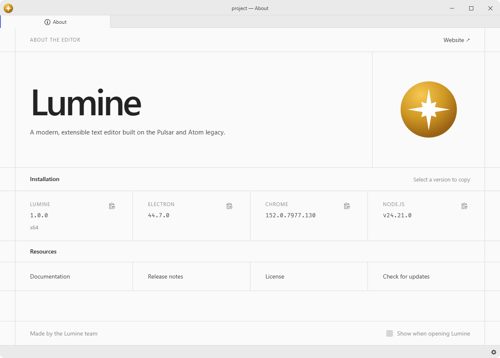
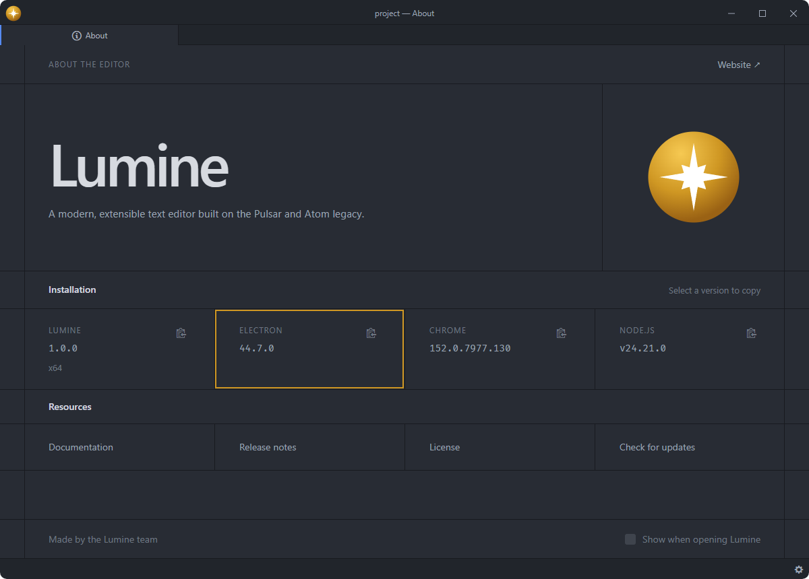

# about

View useful information about your Lumine installation.

Fork of [pulsar-edit/pulsar](https://github.com/pulsar-edit/pulsar) (`packages/about`).

## Features

- **Installation details**: shows the current Lumine version and license.
- **Cross-platform view**: opens a consistent About view on every supported platform.
- **Release notes**: links out to the release notes for the running version.
- **Startup control**: opens on startup by default and can be disabled from the About pane.





## Installation

To install `about` search for it in the Install pane of the Lumine settings, or run the command `lumine --install lumine-code/about`.

## Commands

Commands available in `lumine-workspace`:

- `about:view-release-notes`: open the release notes for the current version in your browser.

## Customization

The About pane follows the active UI theme and adapts to the width of its pane. Adjust its spacing or focus accent in your `styles.css`:

```css
.about {
  --about-gutter: 24px;
  --about-padding: 24px;
  --about-accent: var(--text-color-info);
}
```

## Contributing

Got ideas to make this package better, found a bug, or want to help add new features? Just drop your thoughts on GitHub. Any feedback is welcome!
